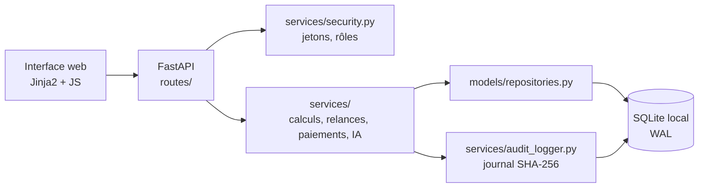

# Recouvrement des factures impayées - Prototype BWAI 2026

Prototype réalisé pour le **cas pratique 1 « Recouvrement automatique des factures impayées »** du hackathon BWAI 2026.

Il aide une PME à :

- importer son portefeuille ;
- calculer ce que chaque client doit vraiment ;
- classer les dossiers par priorité ;
- préparer des relances simulées ;
- faire valider les cas sensibles par une personne ;
- garder un journal de chaque décision.

> [!IMPORTANT]
> Toutes les données sont **fictives**. Aucun message WhatsApp, SMS ou e-mail n'est envoyé et aucun paiement Mobile Money n'est réel. Les références `MOMO-DEMO-…` sont signalées comme simulées dans chaque message.


## Sommaire

1. [Fonctionnalités](#1-fonctionnalités)
2. [Installation](#2-installation)
3. [Configuration](#3-configuration)
4. [Lancement](#4-lancement)
5. [Comptes de test](#5-comptes-de-test)
6. [Scénario de démonstration](#6-scénario-de-démonstration)
7. [Format du fichier d'import](#7-format-du-fichier-dimport)
8. [Règles métier](#8-règles-métier)
9. [Brique IA](#9-brique-ia)
10. [Architecture](#10-architecture)
11. [API REST](#11-api-rest)
12. [Tests automatisés](#12-tests-automatisés)
13. [Reprise après interruption](#13-reprise-après-interruption)
14. [Dépendances et licences](#14-dépendances-et-licences)
15. [Limites connues](#15-limites-connues)
16. [Documentation complémentaire](#16-documentation-complémentaire)


## 1. Fonctionnalités

| Module du guide | Ce que fait le prototype |
|---|---|
| A. Import local | Import Excel multi-feuilles (6 entités) ou CSV, bilan des lignes acceptées et rejetées |
| B. Contrôle des données | Champs obligatoires, formats, dates, montants, devise, doublons, références inconnues, paiements antérieurs à l'émission. Les lignes rejetées peuvent être **corrigées** ou **exclues** depuis l'interface |
| C. Calcul fiable | Solde et jours de retard calculés en arithmétique décimale exacte à partir d'une date de référence |
| D. Statuts | Non échue, échue, partiellement payée, soldée, contestée, couverte par un échéancier |
| E. Priorisation | Score explicable : 40 % retard, 35 % solde, 25 % historique |
| F. Relances graduées | Rappel avant échéance (optionnel), relance 1, relance 2 |
| G. Message personnalisé | Nom du client, référence, échéance, solde vérifié, référence Mobile Money fictive |
| H. Validation humaine | File de revue pour les litiges, gros montants, cas IA incertains, historique inconnu. Décisions : approuver, modifier, suspendre, rejeter |
| I. Vérification avant envoi | Recalcul du solde et du statut, contrôle du canal, du consentement, du délai minimal et du plafond juste avant l'envoi simulé |
| J. Paiements simulés | Enregistrement idempotent, détection de surpaiement avec proposition d'avoir |
| K. Hors connexion | SQLite local, cache persistant, reprise contrôlée sans doublon |
| L. Traçabilité | Journal horodaté, chaîné en SHA-256, protégé contre la modification et la suppression |

Fonctions ajoutées :

- gestion des exceptions depuis la fiche facture : ouvrir ou résoudre un litige, émettre un avoir, accorder un échéancier ;
- paramètres métier modifiables dans l'interface (date de référence, seuils, canal) ;
- reprise humaine sur la qualification IA d'un message ;
- comparaison chiffrée avec une méthode manuelle de référence ;
- démonstration en direct de 20 traitements concurrents ;
- arrêt d'urgence qui bloque tout envoi simulé.


## 2. Installation

### Prérequis

- Python **3.11 ou plus** (développé et testé avec Python 3.14.4)
- Linux, macOS ou Windows
- Aucune connexion Internet requise après installation des dépendances
- Aucune clé d'API externe

### Étapes

```bash
git clone https://github.com/delsDin/bwai.git recouvrement_bwai
cd recouvrement_bwai

python3 -m venv .venv
source .venv/bin/activate        # Windows : .venv\Scripts\activate

pip install -r requirements.txt
cp .env.example .env              # Windows : copy .env.example .env
```


## 3. Configuration

Toute la configuration est dans `.env`. Le fichier `.env` est ignoré par Git. Le fichier `.env.example` contient des valeurs de démonstration sans secret réel.

| Variable | Défaut | Rôle |
|---|---|---|
| `BWAI_REFERENCE_DATE` | `2026-03-15` | Date de référence de tous les calculs. Fixe pour rendre les résultats reproductibles |
| `BWAI_HIGH_AMOUNT_THRESHOLD` | `500000.0` | Solde (FCFA) à partir duquel une validation humaine est obligatoire |
| `BWAI_AI_CONFIDENCE_THRESHOLD` | `0.75` | Confiance IA minimale. En dessous, le dossier part en revue |
| `BWAI_DEFAULT_CHANNEL` | `WHATSAPP` | Canal simulé par défaut : `WHATSAPP`, `SMS` ou `EMAIL` |
| `BWAI_MIN_DAYS_BETWEEN_REMINDERS` | `7` | Délai minimal entre deux relances envoyées sur une facture |
| `BWAI_MAX_REMINDERS_PER_INVOICE` | `3` | Nombre maximal de relances envoyées par facture |
| `BWAI_REQUIRE_AUTH` | `1` | `1` : jeton obligatoire sur les routes protégées. `0` : débogage local uniquement |
| `BWAI_TOKEN_*` | voir `.env.example` | Jetons des comptes de test |
| `BWAI_DATABASE_PATH` | `database/recouvrement.db` | Emplacement de la base SQLite |

La date de référence, les seuils et le canal peuvent aussi être modifiés à chaud depuis le bouton **Paramètres métier** du tableau de bord. Chaque modification recalcule le portefeuille et est inscrite au journal.


## 4. Lancement

```bash
source .venv/bin/activate
uvicorn app:app --reload
```

| Adresse | Contenu |
|---|---|
| http://127.0.0.1:8000/ | Tableau de bord |
| http://127.0.0.1:8000/invoices/FAC-2026-002 | Fiche d'une facture (exemple) |
| http://127.0.0.1:8000/docs | Documentation interactive de l'API (Swagger) |

Au premier lancement, le tableau de bord est **vide**. Deux façons de le remplir :

- bouton **Charger la démo** (portefeuille de 7 factures couvrant les cas T1 à T7) ;
- onglet **Imports** puis le fichier `data/demo_portfolio.xlsx`.

### Remettre à zéro

- Bouton **Effacer tout** (rôle ADMIN), ou
- arrêter le serveur et supprimer `database/recouvrement.db` et `database/app_state_cache.json`.


## 5. Comptes de test

L'authentification se fait par jeton, transmis dans l'en-tête `X-API-Token` (ou `Authorization: Bearer <jeton>`). Dans l'interface, le menu **Opérateur** en haut à droite choisit le compte actif.

| Compte | Rôle | Jeton de démonstration | Peut faire |
|---|---|---|---|
| Koffi | GESTIONNAIRE | `tok-gestionnaire-koffi` | Importer, préparer et envoyer des relances, encaisser, signaler un litige |
| Amina | VALIDATEUR | `tok-validateur-amina` | Tout ce que fait le gestionnaire, plus valider les relances, émettre des avoirs, accorder des échéanciers, résoudre des litiges, modifier les paramètres |
| Boris | VALIDATEUR | `tok-validateur-boris` | Second validateur pour le principe des quatre yeux |
| Direction | ADMIN | `tok-admin-direction` | Tout, plus réinitialiser, effacer, restaurer le cache, arrêt d'urgence |

Règles appliquées :

- un appel sans jeton sur une route protégée renvoie **401** ;
- un rôle insuffisant renvoie **403** ;
- une personne qui a préparé une relance ne peut pas l'approuver elle-même (**quatre yeux**) ;
- les jetons sont stockés hachés en SHA-256 dans la table `users`.

> [!WARNING]
> Ces jetons sont des jetons de **démonstration**. Le menu Opérateur les contient pour permettre au jury de changer de rôle en un clic. Ne pas utiliser ce mécanisme hors démonstration (voir [Limites connues](#15-limites-connues)).


## 6. Scénario de démonstration

Durée : 3 à 4 minutes. Partir d'une base vide.

| # | Action | Ce qu'on montre |
|---|---|---|
| 1 | Opérateur **Koffi**. Onglet **Imports**, charger `data/demo_portfolio.xlsx` | 17 lignes acceptées, 1 rejetée (`FAC-ERR-DEMO`, montant −45 000) avec son motif |
| 2 | Sur la ligne rejetée, **Corriger**, remplacer `-45000` par `45000`, valider | La ligne est réintégrée, la correction est tracée |
| 3 | Revenir au **Portefeuille** | Encours, retards, dossiers suspendus, règlements simulés |
| 4 | Ouvrir `FAC-2026-003` | Solde = 250 000 − 80 000 (paiement) − 20 000 (avoir) = 150 000 FCFA, 30 jours de retard |
| 5 | Lire le score de `FAC-2026-007` | Score 0,77 : 38 jours de retard, solde au-dessus du seuil, historique 4/6 |
| 6 | **Préparer les relances** puis onglet **Revue humaine** | `FAC-2026-007` bloquée (gros montant), `FAC-2026-005` bloquée (litige) |
| 7 | Opérateur **Amina**, **Examiner** `FAC-2026-007`, approuver | Relance validée par une autre personne que son auteur |
| 8 | Onglet **Relances**, **Simuler l'envoi** | Solde revérifié, envoi inscrit comme simulé |
| 9 | Encaisser le solde de `FAC-2026-003`, puis tenter d'envoyer sa relance | Relance annulée car la facture est soldée |
| 10 | Encaisser deux fois avec la même référence | Second paiement refusé : une seule comptabilisation |
| 11 | Onglet **Audit & IA** | Journal, vérification de la chaîne SHA-256, comparaison à la méthode manuelle, test 20 threads |
| 12 | Terminal : `pytest -q` | 49 tests verts |


## 7. Format du fichier d'import

### Excel (recommandé)

Un classeur `.xlsx` avec une feuille par entité. Le nom des feuilles n'est pas sensible à la casse ; les noms anglais sont aussi acceptés.

| Feuille | Colonnes obligatoires | Colonnes facultatives |
|---|---|---|
| `Clients` | `client_id`, `nom_affiche`, `contact_simule` | `canal_prefere`, `consentement_contact`, `nb_factures_historiques`, `nb_retards_historiques` |
| `Factures` | `invoice_id`, `client_id`, `date_emission`, `date_echeance`, `montant_initial` | `devise`, `statut_source`, `dernier_message_client` |
| `Paiements` | `payment_id`, `invoice_id`, `date_paiement`, `montant`, `reference_fictive` | |
| `Avoirs` | `credit_note_id`, `invoice_id`, `date_avoir`, `montant`, `motif` | |
| `Echeanciers` | `plan_id`, `invoice_id`, `date_prochaine_echeance`, `montant_prevu` | `statut` (`ACTIF`, `ROMPU`, `TERMINE`) |
| `Contestations` | `dispute_id`, `invoice_id`, `motif`, `date_ouverture` | `statut` (`OUVERT`, `RESOLU`) |

Dates au format `AAAA-MM-JJ`. Montants en FCFA. Les entités sont importées dans l'ordre du tableau : une facture qui référence un client absent est rejetée.

### CSV

Un fichier CSV contient **une seule entité**. Le type est reconnu à partir des colonnes (`montant_initial` → factures, `nom_affiche` → clients, `payment_id` → paiements, etc.). Importer d'abord les clients, puis les factures, puis le reste.

### Contrôles appliqués

| Contrôle | Exemple de rejet |
|---|---|
| Champ obligatoire, type, format de date | `date_echeance` absente ou illisible |
| Montant strictement positif | `montant_initial = -15000` |
| Échéance postérieure à l'émission | échéance avant émission |
| Devise | seules `FCFA`, `XOF`, `CFA` sont acceptées (normalisées en `FCFA`) |
| Historique cohérent | plus de retards que de factures historiques |
| Doublons | identifiant déjà présent, ou même `(facture, référence de paiement)` |
| Références | client ou facture inconnus |
| Chronologie | paiement ou avoir daté avant l'émission de la facture |

Aucune ligne invalide n'est intégrée silencieusement : elle est inscrite dans l'onglet **Imports** avec son motif, puis corrigée ou exclue.


## 8. Règles métier

### Calculs

```
Solde restant   = max(0, montant initial − paiements validés − avoirs)
Excédent        = max(0, paiements validés + avoirs − montant initial)
Jours de retard = max(0, date de référence − date d'échéance), 0 si la facture est soldée
```

- Les montants sont calculés en `Decimal`, arrondis au centime (arrondi commercial), pour éviter les erreurs d'arrondi des nombres à virgule.
- L'identité `solde + payé + avoirs − excédent = montant initial` est vérifiée par les tests.
- Un surpaiement solde la facture, déclenche une alerte au journal et propose un avoir ou un remboursement.

### Statuts

Une facture peut être à la fois échue et partiellement payée. Le prototype tranche avec un ordre de priorité, et expose aussi les deux dimensions séparément.

| Ordre | Statut affiché | Condition |
|---|---|---|
| 1 | `SOLDEE` | Solde nul |
| 2 | `CONTESTEE` | Au moins une contestation ouverte |
| 3 | `COUVERTE_PAR_ECHEANCIER` | Échéancier actif dont la prochaine échéance n'est pas dépassée |
| 4 | `PARTIELLEMENT_PAYEE` | Un paiement ou avoir imputé, solde positif |
| 5 | `ECHUE` | Échéance dépassée, aucun paiement |
| 6 | `NON_ECHUE` | Échéance non atteinte, aucun paiement |

Champs complémentaires renvoyés par le calcul :

- `statut_paiement` : `IMPAYEE`, `PARTIELLEMENT_PAYEE`, `SOLDEE` ;
- `statut_echeance` : `NON_ECHUE`, `ECHUE`, `SOLDEE`.

Un échéancier dont la prochaine échéance est dépassée ne protège plus la facture : elle redevient relançable.

### Priorisation

```
Score = 0,40 × min(retard / 60 j, 1)
      + 0,35 × min(solde / seuil gros montant, 1)
      + 0,25 × (retards antérieurs / factures antérieures)
```

- Si l'historique est inconnu, la composante vaut 0,5 et le dossier part en revue.
- Les factures soldées, contestées ou sous échéancier ne sont pas classées comme relances prêtes.
- L'explication du score est affichée pour chaque facture.

Le score organise le travail. Il ne prédit pas le non-paiement.

### Relances

| Niveau | Déclenchement |
|---|---|
| `RAPPEL_PRE_ECHEANCE` | 0 à 3 jours avant l'échéance (désactivé par défaut) |
| `RELANCE_1` | 1 à 14 jours de retard |
| `RELANCE_2` | 15 jours de retard ou plus |

Une relance part en **revue humaine** si au moins une condition est vraie :

- litige ouvert ;
- solde au moins égal au seuil de gros montant ;
- message client classé sensible par l'IA, ou confiance sous le seuil, ou message hors vocabulaire ;
- historique client inconnu ;
- consentement absent ou canal demandé différent du canal préféré.

Juste avant l'envoi simulé, dans une seule transaction, le moteur vérifie dans l'ordre :

1. arrêt d'urgence ;
2. relance déjà envoyée ;
3. solde et statut recalculés (annulation si soldée, contestée ou sous échéancier) ;
4. canal et consentement ;
5. validation humaine accordée ;
6. plafond de relances ;
7. délai minimal depuis la dernière relance.

### Idempotence

| Opération | Protection |
|---|---|
| Paiement | Clé unique `(invoice_id, reference_fictive)` |
| Relance | Clé unique `(invoice_id, niveau_relance)` et `idempotency_key` |
| Envoi | Transition conditionnelle `APPROUVEE → SIMULEE`, vérifiée par le nombre de lignes modifiées |
| Concurrence | Transactions SQLite `BEGIN IMMEDIATE`, mode WAL, délai d'attente de 30 s |


## 9. Brique IA

L'IA a **un seul rôle** : lire le dernier message d'un client et décider s'il doit passer par une personne. Elle ne calcule aucun montant et ne déclenche aucun envoi.

| Élément | Valeur |
|---|---|
| Modèle | TF-IDF (mots et paires de mots) + régression logistique, scikit-learn |
| Fonctionnement | 100 % local, entraînement au démarrage en moins d'une seconde |
| Classes | `LITIGE`, `DEMANDE_ECHEANCIER`, `ANNONCE_PAIEMENT`, `RETARD_SIMPLE` |
| Données | 250 messages d'entraînement (`data/train.csv`), 100 messages de test séparés (`data/test.csv`), tous rédigés à la main et fictifs |
| Exactitude sur le jeu de test | 89 % (règles par mots-clés : 36 %) |
| Messages sensibles laissés partir sans revue | 0 sur 82 |

Explicabilité : pour chaque message, l'interface montre les mots qui ont le plus pesé, la probabilité de chaque classe et l'écart entre les deux premières.

Reprise humaine : depuis la fiche facture, un opérateur peut corriger la classe retenue. Sa décision est conservée lors des recalculs et inscrite au journal.

Reproduire l'évaluation :

```bash
python -m services.ai_classifier
```

Détails, erreurs observées et limites : [FICHE_IA.md](FICHE_IA.md).


## 10. Architecture



```
recouvrement_bwai/
├── app.py                      Point d'entrée FastAPI
├── config.py                   Paramètres lus depuis .env
├── database/
│   ├── schema.sql              Tables, contraintes, triggers du journal
│   └── db.py                   Connexions, transactions atomiques, initialisation
├── models/
│   ├── schemas.py              Validation Pydantic (import et API)
│   └── repositories.py         Accès aux données, démo, cache, exceptions métier
├── services/
│   ├── importer.py             Import et contrôle des données
│   ├── calculator.py           Soldes, retards, statuts, rejeu
│   ├── prioritizer.py          Score de priorité
│   ├── reminder_engine.py      Relances, revue humaine, vérification avant envoi
│   ├── payment_service.py      Paiements simulés
│   ├── recovery_service.py     Reprise après interruption
│   ├── ai_classifier.py        Classification des messages
│   ├── benchmark_service.py    Comparaison à la référence, test de concurrence
│   ├── audit_logger.py         Journal chaîné
│   └── security.py             Authentification, rôles, masquage
├── routes/                     Routes web et API
├── frontend/                   Gabarits HTML, CSS, JavaScript
├── data/                       Portefeuille de démo, jeux IA
├── notebooks/                  Reproduction de l'évaluation IA
└── tests/                      Tests automatisés
```

Les calculs sont dans `services/` et ne dépendent ni des routes ni de l'interface.


## 11. API REST

Documentation complète : http://127.0.0.1:8000/docs. Routes principales :

| Méthode | Route | Rôle minimal |
|---|---|---|
| GET | `/api/dashboard`, `/api/invoices`, `/api/invoices/{id}` | — |
| POST | `/api/import/upload` | GESTIONNAIRE |
| POST | `/api/import/errors/{id}/resolve` · DELETE `/api/import/errors/{id}` | GESTIONNAIRE |
| POST | `/api/reminders/prepare-all`, `/api/reminders/prepare/{invoice_id}` | GESTIONNAIRE |
| POST | `/api/review/{reminder_id}` | VALIDATEUR |
| POST | `/api/reminders/{reminder_id}/send` | GESTIONNAIRE |
| POST | `/api/payments/simulate` | GESTIONNAIRE |
| POST | `/api/disputes` | GESTIONNAIRE |
| POST | `/api/disputes/{id}/resolve`, `/api/credit-notes`, `/api/installment-plans` | VALIDATEUR |
| GET / POST | `/api/settings` | — / VALIDATEUR |
| POST | `/api/ai/classify` · GET `/api/ai/evaluation` | — |
| POST | `/api/invoices/{id}/ai-override` | GESTIONNAIRE |
| GET | `/api/benchmark` | — |
| POST | `/api/system/replay`, `/api/system/concurrency-proof` | GESTIONNAIRE |
| POST | `/api/system/recover` | VALIDATEUR |
| GET | `/api/audit-logs`, `/api/audit-logs/verify` | — |
| POST | `/api/system/reset-demo`, `/api/system/clear`, `/api/system/cache/restore`, `/api/system/emergency-stop` | ADMIN |

Exemple :

```bash
curl -X POST http://127.0.0.1:8000/api/payments/simulate \
  -H "X-API-Token: tok-gestionnaire-koffi" \
  -H "Content-Type: application/json" \
  -d '{"invoice_id": "FAC-2026-003", "montant": 50000, "reference_fictive": "MOMO-TEST-001"}'
```


## 12. Tests automatisés

```bash
source .venv/bin/activate
pytest -q
```

Résultat attendu : **49 tests réussis** en une quinzaine de secondes. Chaque test utilise sa propre base temporaire : la base de démonstration n'est pas modifiée.

| Fichier | Couverture |
|---|---|
| `test_step1_calculations.py` | T1 à T6 : soldes, retards, statuts, score |
| `test_step2_ai.py` | Classification et seuil de confiance |
| `test_step3_import.py` | T12 : ligne invalide et doublon |
| `test_step4_payments.py` | T9 : paiement enregistré deux fois |
| `test_step5_reminders_and_recovery.py` | T7, T8, T10, T11 |
| `test_step6_api_e2e.py` | Parcours de bout en bout par l'API, exceptions, paramètres |
| `test_step7_concurrency.py` | 20 threads simultanés sur envoi, paiement, préparation |
| `test_step8_ai_evaluation.py` | Jeu de test séparé, calibration, garde-fous, explicabilité, reprise humaine |
| `test_step9_security.py` | Rôles, quatre yeux, journal infalsifiable, masquage, arrêt d'urgence, failles corrigées |
| `test_step10_reliability_and_users.py` | Surpaiement, invariants, rejeu SHA-256, délai entre relances, arithmétique exacte |

Correspondance avec le plan de tests du guide :

| Test | Fonction |
|---|---|
| T1 | `test_t1_facture_non_echue_solde_positif` |
| T2 | `test_t2_facture_echue_aucun_paiement` |
| T3 | `test_t3_paiement_partiel_et_avoir` |
| T4 | `test_t4_paiement_total` |
| T5 | `test_t5_facture_contestee`, `test_t5_disputed_invoice_goes_to_human_review_queue` |
| T6 | `test_t6_echeancier_actif` |
| T7 | `test_t7_montant_superieur_au_seuil_validation_humaine_obligatoire` |
| T8 | `test_t8_preference_de_contact_incompatible_aucune_simulation_envoi` |
| T9 | `test_t9_paiement_enregistre_deux_fois_une_seule_comptabilisation` |
| T10 | `test_t10_double_clic_et_reprise_apres_interruption_sans_doublon` |
| T11 | `test_t11_relance_preparee_puis_facture_reglee_annule_la_relance` |
| T12 | `test_t12_ligne_import_invalide_et_doublon_non_integres_silencieusement` |


## 13. Reprise après interruption

1. Toutes les données sont dans la base SQLite locale. Une coupure réseau n'a aucun effet.
2. Après chaque action, l'état est aussi copié dans `database/app_state_cache.json`.
3. Si la base est perdue mais que le cache existe, le tableau de bord recharge l'état au démarrage. Le cache n'est accepté que si la chaîne SHA-256 du journal qu'il contient est intacte.
4. Le bouton **Reprise hors ligne** recalcule le portefeuille et ne prépare que les relances qui n'existent pas encore. Les clés uniques empêchent tout doublon.


## 14. Dépendances et licences

Versions utilisées lors des tests :

| Bibliothèque | Version testée | Licence | Usage |
|---|---|---|---|
| FastAPI | 0.165.0 | MIT | API et serveur web |
| Starlette | 1.10.0 | BSD-3-Clause | Socle de FastAPI |
| Uvicorn | 0.54.0 | BSD-3-Clause | Serveur ASGI |
| Jinja2 | 3.1.6 | BSD-3-Clause | Gabarits HTML |
| Pydantic | 2.14.4 | MIT | Validation des données |
| python-multipart | 0.0.34 | Apache-2.0 | Envoi de fichiers |
| python-dotenv | 1.2.4 | BSD-3-Clause | Lecture de `.env` |
| pandas | 3.1.1 | BSD-3-Clause | Lecture Excel et CSV |
| openpyxl | 3.1.5 | MIT | Format `.xlsx` |
| scikit-learn | 1.9.1 | BSD-3-Clause | Modèle de classification |
| NumPy / SciPy | 2.5.5 / 1.18.1 | BSD-3-Clause | Dépendances de scikit-learn |
| pytest | 9.2.0 | MIT | Tests |
| httpx | 0.28.1 | BSD-3-Clause | Client de test FastAPI |

- Aucun modèle pré-entraîné, aucun service payant, aucune API externe.
- Base de données : SQLite (domaine public), incluse dans Python.
- Données : portefeuille et messages entièrement fictifs. Méthode : [data/methode_generation_jeux.md](data/methode_generation_jeux.md).


## 15. Limites connues

- **Authentification de démonstration.** Les jetons sont fixes et le menu Opérateur les contient dans la page. Il n'y a ni mot de passe, ni session, ni expiration.
- **Données réduites et fictives.** 7 factures de démonstration, 350 messages rédigés à la main. Les performances de l'IA ne valent que pour ce corpus.
- **Langues locales.** Les messages en fon, yoruba ou mina ne sont pas reconnus. Ils sont détectés comme hors vocabulaire et envoyés en revue humaine.
- **Une relance par niveau et par facture.** Une relance rejetée ou annulée ne peut pas être recréée au même niveau.
- **Échéanciers simplifiés.** Seule la prochaine échéance est suivie, pas le détail de chaque versement prévu.
- **Envois et paiements simulés.** Aucune intégration réelle WhatsApp, SMS, e-mail ou Mobile Money.
- **Mono-poste.** SQLite convient à un usage local. Un usage à plusieurs postes demanderait un serveur de base de données.
- **Comparaison à la référence.** Le temps manuel de 210 s par dossier est une estimation, pas une mesure chronométrée auprès d'utilisateurs.


## 16. Documentation complémentaire

| Document | Contenu |
|---|---|
| [FICHE_IA.md](FICHE_IA.md) | Modèle, données, évaluation, calibration, erreurs, limites |
| [FIABILITE_METIER.md](FIABILITE_METIER.md) | Preuves de fiabilité : concurrence, invariants, rejeu |
| [SECURITE_ET_MAITRISE.md](SECURITE_ET_MAITRISE.md) | Rôles, quatre yeux, journal, masquage, arrêt d'urgence |
| [LIEN_FONCTIONNALITES_CODE.md](LIEN_FONCTIONNALITES_CODE.md) | Correspondance entre exigences et code |
| [ETAPES_DEVELOPPEMENT_ET_TESTS.md](ETAPES_DEVELOPPEMENT_ET_TESTS.md) | Étapes de développement |
| [data/methode_generation_jeux.md](data/methode_generation_jeux.md) | Construction des jeux de données IA |
| [notebooks/reproduction_et_evaluation_ia.ipynb](notebooks/reproduction_et_evaluation_ia.ipynb) | Reproduction de l'évaluation IA |
